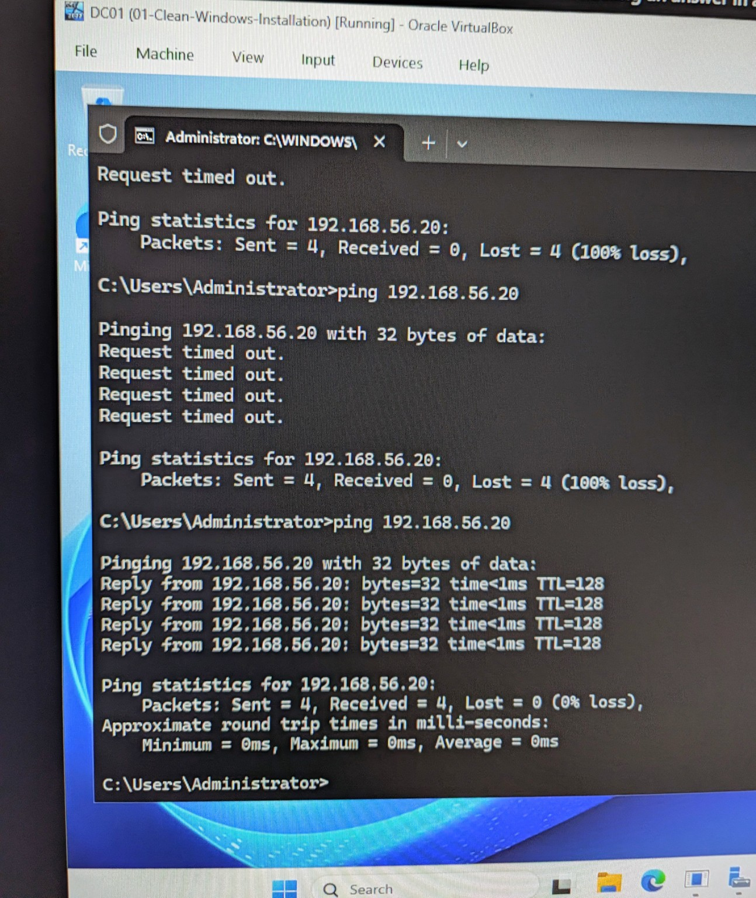
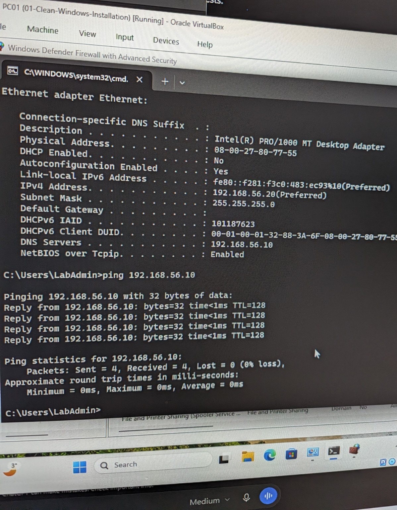
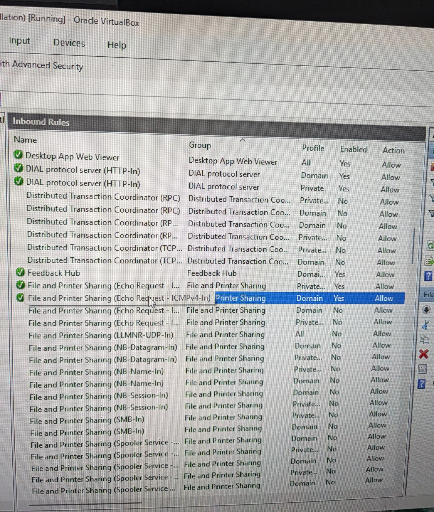
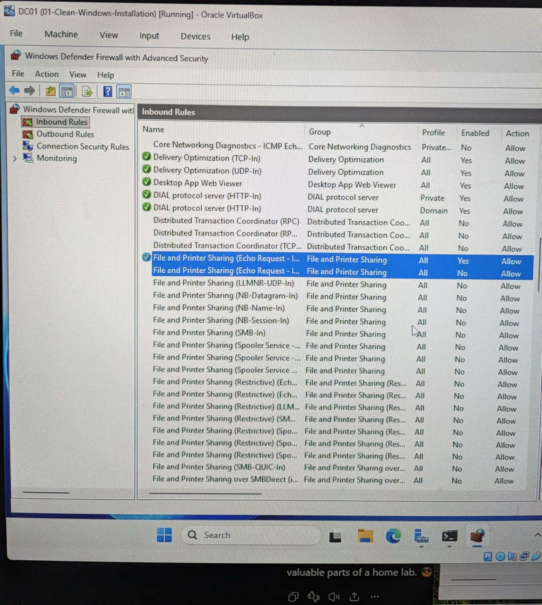
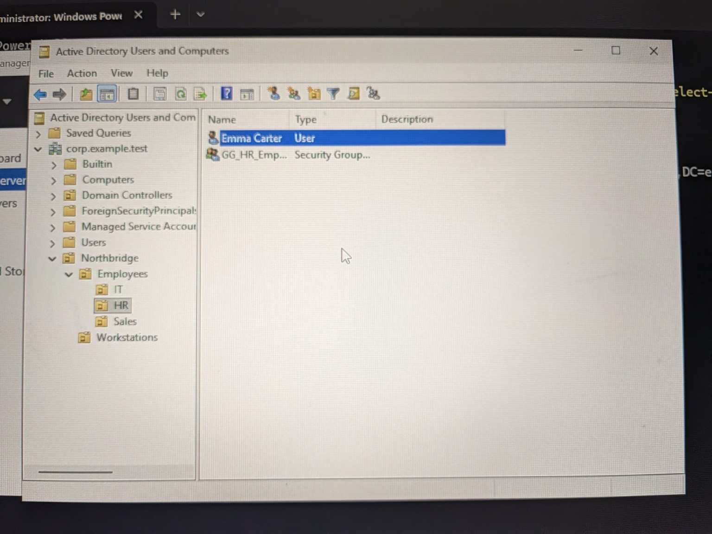
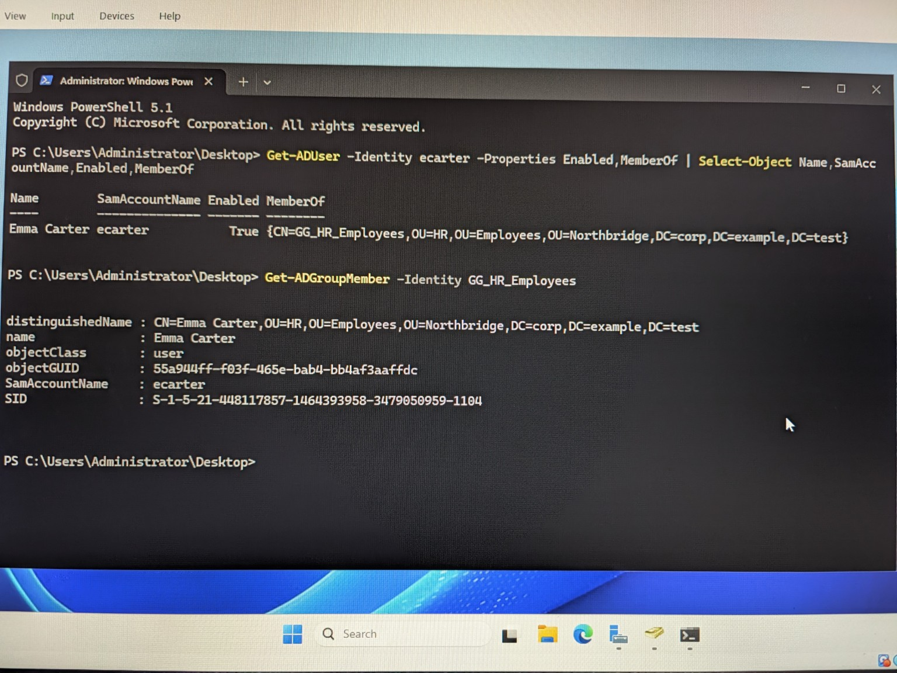
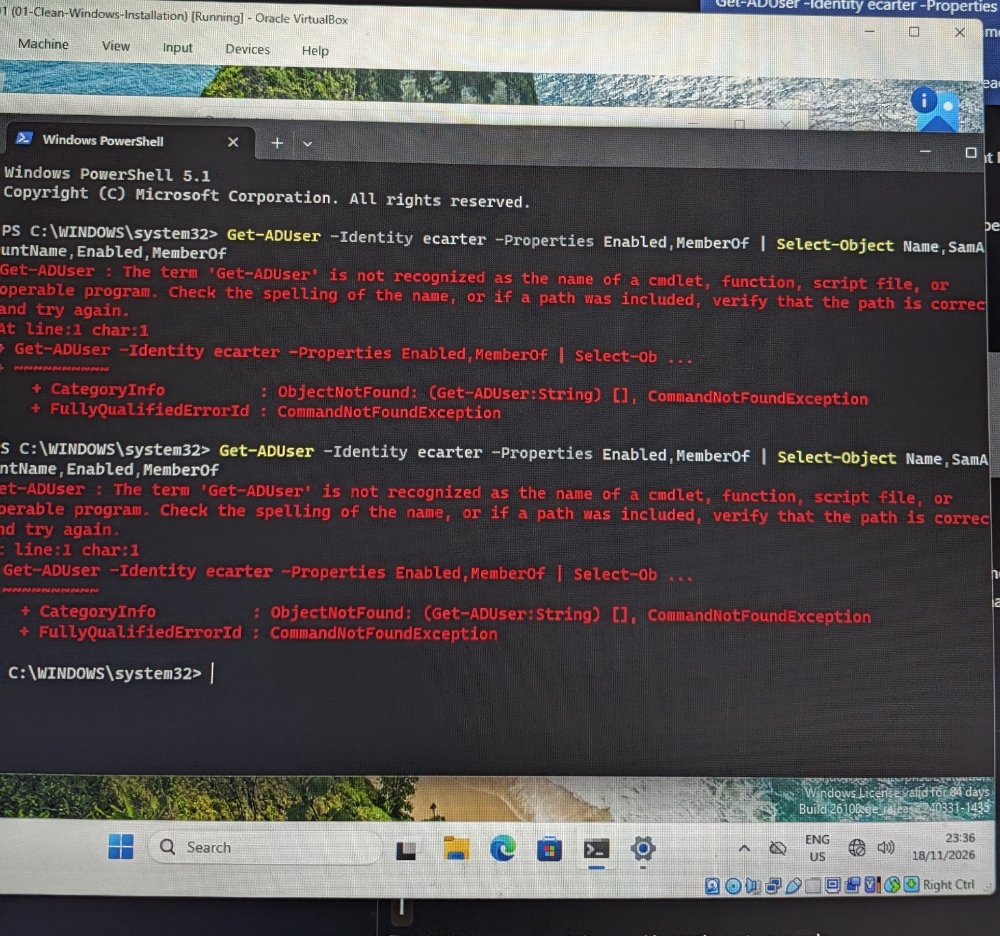

# INC-001 — Active Directory Employee Onboarding

**Project:** Northbridge IT Ltd (fictional organisation)  
**Status:** Completed  
**Category:** User Account Management  
**Environment:** Isolated VirtualBox home lab

## 1. Objective

Simulate the setup of a small company IT environment and complete a service-desk request to create an HR employee account. The work covered installing two Windows virtual machines, configuring an isolated network, troubleshooting ICMP connectivity, deploying an Active Directory domain controller, creating organisational units (OUs), provisioning a user and group, and verifying the result in PowerShell.

All users, hostnames and incidents in this report are part of an authorised fictional lab.

## 2. Lab environment

| Component | Configuration |
|---|---|
| Host hypervisor | Oracle VirtualBox on Windows desktop |
| Server | Windows Server 2025 Evaluation (Desktop Experience) |
| Workstation | Windows 11 Enterprise Evaluation |
| Domain | `corp.example.test` |
| Domain controller | `DC01` — `192.168.56.10` |
| Workstation | `PC01` — `192.168.56.20` |
| Host-only adapter | `192.168.56.1/24` |
| Subnet | `192.168.56.0/24` (`255.255.255.0`) |
| PC01 DNS | `192.168.56.10` (DC01) |
| VirtualBox VM resources | 2 vCPUs, 6 GB RAM and 80 GB dynamically allocated virtual disk for each Windows VM |

### Network layout

```text
Windows host running VirtualBox
  |
  +-- Host-only network: 192.168.56.0/24
        |
        +-- DC01: 192.168.56.10
        |     Windows Server 2025
        |     AD DS + DNS
        |
        +-- PC01: 192.168.56.20
              Windows 11 Enterprise
              DNS -> 192.168.56.10
```

The host-only lab network allows communication among the virtual machines and host without directly bridging the domain environment to the home LAN. There is no default gateway on the lab adapters, so these adapters alone do not provide internet access.

## 3. Phase 1 — Deploy the virtual machines

1. Downloaded the official **Windows Server 2025 Evaluation ISO** and **Windows 11 Enterprise Evaluation ISO** from Microsoft.
2. Created **DC01** in VirtualBox with the Windows Server ISO, 2 virtual CPUs, 6 GB RAM and an 80 GB dynamically allocated virtual disk. Used the manual installation process rather than an unattended installation.
3. Installed **Windows Server 2025 Standard Evaluation (Desktop Experience)** so the VM had Server Manager and the graphical administration tools.
4. Completed initial Windows Server setup and set the local Administrator password. Dismissed the optional Azure Arc prompt because this is an on-premises lab.
5. Renamed the Windows Server computer to **DC01** in Server Manager → Local Server → Computer name, then restarted. Also renamed its VirtualBox entry to DC01 for consistency. The VirtualBox display name and Windows hostname are separate settings.
6. Created **PC01** in VirtualBox with the Windows 11 Enterprise ISO, 2 virtual CPUs, 6 GB RAM and an 80 GB dynamically allocated virtual disk. Used the supported Windows 11 virtual hardware settings, including EFI and TPM 2.0.
7. Completed the Windows 11 installation.
8. Took **clean-install snapshots** of both VMs before making domain/network changes. The snapshot names included `01-Clean-Windows-Installation`.

**Why these steps matter:** Virtual machines allow repeatable IT scenarios without altering the physical Windows installation. Snapshots provide a recovery point if configuration changes cause problems.

**Useful VirtualBox tip:** To send Windows Server's Ctrl+Alt+Del secure attention sequence, use **Input → Keyboard → Insert Ctrl-Alt-Del** (or the VirtualBox Host-key shortcut), instead of pressing Ctrl+Alt+Del on the host.

## 4. Phase 2 — Configure the isolated network

1. Powered off both VMs.
2. In VirtualBox's Host-only Network Manager, configured a host-only network using `192.168.56.1` with subnet mask `255.255.255.0` and disabled its DHCP server.
3. Attached both **DC01** and **PC01** to the **same host-only adapter** in each VM's Network settings.
4. In each Windows guest, opened the network adapter settings using `Win + R` → `ncpa.cpl`, then opened **Ethernet → Properties → Internet Protocol Version 4 (TCP/IPv4)**.
5. Assigned the static IPv4 settings below. Both VMs were on the same subnet and did not require a default gateway for local communication.

| Guest | IPv4 address | Subnet mask | Preferred DNS | Gateway |
|---|---|---|---|---|
| DC01 | `192.168.56.10` | `255.255.255.0` | `192.168.56.10` | None |
| PC01 | `192.168.56.20` | `255.255.255.0` | `192.168.56.10` | None |

6. Used `ipconfig /all` to inspect PC01's adapter information and confirm its static address and DNS configuration.
7. Tested both directions of connectivity using Command Prompt:

```cmd
ping 192.168.56.10
ping 192.168.56.20
```

**Why DNS points to DC01:** Active Directory clients need DNS to discover domain controllers and their services. PC01's preferred DNS server therefore points to the domain controller rather than a public resolver.

### Troubleshooting — Ping requests timed out

**Symptom:** Initial ping tests failed with **4 packets sent and 0 received (100% loss)**, even though the VMs had addresses in the same subnet.

**Investigation:** Checked the IPv4 settings and inspected **Windows Defender Firewall with Advanced Security** (`wf.msc`) → **Inbound Rules** for **File and Printer Sharing (Echo Request - ICMPv4-In)**.

**Resolution:** Enabled the relevant ICMPv4 echo-request inbound firewall rules in the lab, rather than disabling Windows Firewall completely.

**Verification:** Repeated the ping tests. DC01 received **4/4 replies** from PC01, and PC01 received **4/4 replies** from DC01, both with **0% packet loss**.

#### Evidence — DC01 ping before and after



#### Evidence — PC01 network configuration and successful ping



#### Evidence — PC01 firewall rules



#### Evidence — DC01 firewall rules



**Lesson learned:** A failed ping alone does not prove the network is broken. Host-based firewall restrictions can prevent ICMP responses despite correct addressing and an operational network.

## 5. Phase 3 — Deploy Active Directory Domain Services

1. On DC01, opened **Server Manager → Manage → Add Roles and Features**.
2. Chose **Role-based or feature-based installation** and selected the local server.
3. Selected the **Active Directory Domain Services (AD DS)** server role and installed the required management features.
4. After installation, clicked the Server Manager notification flag → **Promote this server to a domain controller**.
5. Selected **Add a new forest** and entered the root domain `corp.example.test`.
6. In **Domain Controller Options**, kept **DNS Server** and **Global Catalog (GC)** enabled. Did not select **Read-only Domain Controller (RODC)**.
7. Set and securely retained a **Directory Services Restore Mode (DSRM)** password; it is not included in this repository.
8. Continued through the DNS and prerequisite checks, installed the configuration and allowed DC01 to restart.
9. Confirmed the server was operating as a domain controller. DNS is installed as part of promotion when the DNS Server option is selected.

**Why these steps matter:** AD DS centralises identities, computers and administrative policies. DNS allows domain-joined clients to locate the services needed for domain authentication. The Global Catalog helps with directory searches and logon-related functions.

## 6. Phase 4 — INC-001: New HR employee onboarding

### Service desk request

> HR has hired a fictional employee, Emma Carter. Create an enabled domain account under the HR department and give it HR security-group membership.

### Step 1 — Open Active Directory administration

On DC01, opened **Server Manager → Tools → Active Directory Users and Computers (ADUC)** and expanded `corp.example.test`.

### Step 2 — Create organisational units

Created a parent OU **Northbridge**, added **Employees** and **Workstations**, and created departmental OUs under Employees: **HR**, **IT**, and **Sales**.

```text
corp.example.test
└── Northbridge
    ├── Employees
    │   ├── HR
    │   │   ├── Emma Carter (user)
    │   │   └── GG_HR_Employees (security group)
    │   ├── IT
    │   └── Sales
    └── Workstations
```

**Why:** OUs organise directory objects and can be used for Group Policy scoping and delegated administration. They do **not** grant access permissions by themselves.

### Step 3 — Create the HR security group

Inside the HR OU, selected **New → Group** and created:

| Setting | Value |
|---|---|
| Group name | `GG_HR_Employees` |
| Group scope | Global |
| Group type | Security |

**Why:** Security groups let administrators manage access through membership rather than granting permissions to each employee individually. Resource permissions will be configured in a later ticket.

### Step 4 — Create the employee account

Inside the HR OU, selected **New → User** and entered:

| Setting | Value |
|---|---|
| Name | Emma Carter (fictional) |
| Username / sAMAccountName | `ecarter` |
| Account status | Enabled |
| Initial credential | Strong temporary password, not documented here |
| First sign-in | Require password change at next logon |

**Why:** This simulates a common first-line helpdesk onboarding task. A temporary password should not remain the employee's long-term credential.

### Step 5 — Add the user to the group

Opened Emma Carter's account properties → **Member Of** → **Add**, entered `GG_HR_Employees`, checked the group name and saved.

### Step 6 — Verify using PowerShell

On DC01, retrieved the user account and group information:

```powershell
Get-ADUser -Identity ecarter -Properties Enabled,MemberOf |
    Select-Object Name,SamAccountName,Enabled,MemberOf
```

```powershell
Get-ADGroupMember -Identity GG_HR_Employees
```

**Verified result:** Emma Carter (`ecarter`) was enabled (`True`), and her membership in `GG_HR_Employees` was visible both from the user properties and in the group-member query.

#### Evidence — Active Directory OU structure and account



#### Evidence — Successful PowerShell account and group verification



### Additional troubleshooting — Get-ADUser not recognised

**Symptom:** Initially, running `Get-ADUser` produced a `CommandNotFoundException` / **'Get-ADUser' is not recognized** message.

**Cause and lesson:** `Get-ADUser` comes from the **ActiveDirectory PowerShell module**, which is not available in every PowerShell environment. Windows client devices may require **Remote Server Administration Tools (RSAT)** to use these administrative cmdlets.

**Resolution:** Ran the verification commands successfully in the domain-controller environment where the Active Directory module was available. Installing RSAT on PC01 remains a possible future exercise; it was **not** part of this ticket.

#### Evidence — Initial cmdlet error



## 7. Key commands explained

| Command / syntax | Purpose |
|---|---|
| `ipconfig /all` | Show detailed Windows IP and DNS configuration |
| `ping 192.168.56.10` | Test ICMP reachability to the domain controller |
| `ncpa.cpl` | Open network-adapter settings |
| `wf.msc` | Open Windows Defender Firewall with Advanced Security |
| `Get-ADUser` | Retrieve an AD user object |
| `-Identity ecarter` | Specify which AD user to retrieve |
| `-Properties MemberOf` | Request group membership information in addition to default properties |
| `|` (PowerShell pipeline) | Pass an object to another cmdlet |
| `Select-Object` | Choose which output properties to display |
| `Get-ADGroupMember` | List members of an AD group |

PowerShell pipelines carry **objects**, not merely formatted text. The `MemberOf` property contains distinguished names (DNs), such as `CN=GG_HR_Employees,OU=HR,OU=Employees,OU=Northbridge,DC=corp,DC=example,DC=test`.

## 8. Outcome and lessons learned

**INC-001 completed:** Created the organisational structure, a fictional HR employee account, and an HR global security group; added the employee to that group and confirmed the account state and membership through PowerShell.

**Additional infrastructure experience:** Installed and configured Windows VMs, deployed a domain controller with DNS, isolated the virtual network, and fixed ICMP firewall restrictions.

**Skills demonstrated:** Windows Server, Active Directory Domain Services, OU administration, user provisioning, security-group management, IPv4/DNS configuration, host-based firewall troubleshooting, PowerShell, and technical documentation.

## 9. Next steps (not yet completed)

- **INC-002:** Join PC01 to `corp.example.test` and test login as the newly created domain user.
- Later tickets: password reset, account lockout, department access changes, offboarding, file permissions, Group Policy and DNS/login troubleshooting.

## 10. Evidence and privacy notes

All image references above point to the local `screenshots/` folder. The screenshots demonstrate configuration and command output; they do not disclose account passwords.

Existing Git commits may still retain earlier screenshot versions even after newer crops are uploaded. Review historical commits separately if any old images contained information you do not want public.
